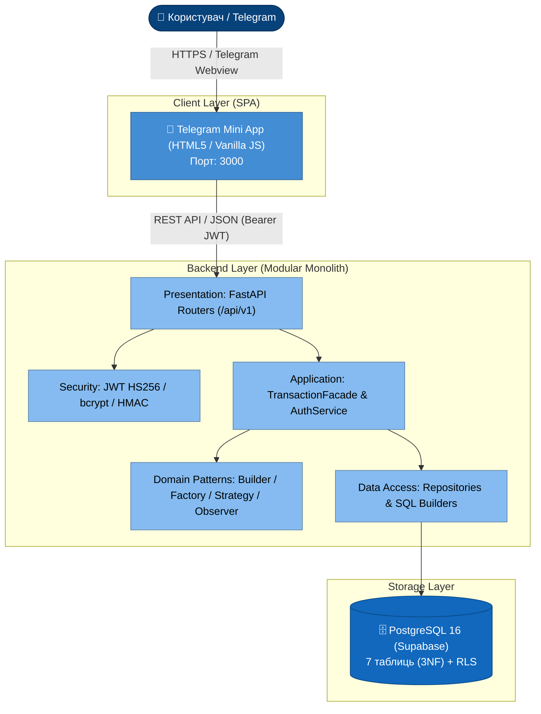

<p align="center">
  
</p>

# 💰 Expense Tracker — Повний наскрізний проєкт (Лабораторні роботи №1–8)


> **Повноцінний Telegram Mini App для обліку особистих фінансів із 4-рівневою архітектурою Modular Monolith, GoF-патернами, захистом STRIDE, 37 автоматичними тестами та CI/CD конвеєром.**

---

## 👥 Команда розробників (Національний університет «Одеська юридична академія», ІПЗ-42)

* **Петрушенко Мілєна Романівна** — **Team Lead & Lead Software Architect**  
  *Архітектура Modular Monolith, ADR, шар валідації DTO (Pydantic), GoF патерни, TransactionFacade, C4 моделі.*
* **Чугунникова Вікторія Ігорівна** — **DBA & DevOps Engineer**  
  *Реляційна модель PostgreSQL/Supabase (3NF), RLS-політики, SQL-міграції, Docker контейнеризація, CI/CD GitHub Actions.*
* **Бевзюк Єгор Сергійович** — **QA Lead & Frontend Engineer**  
  *Автоматизовані тести на pytest (37 тестів, покриття 59%), навантажувальний бенчмарк loadtest.py, адаптивний Telegram Mini App.*

**Перевірив:** викладач кафедри кібербезпеки **Ніколаєнко С.В.**

---

## 📚 Повний цикл лабораторних робіт (Еволюція проєкту)

| Етап | Тема лабораторної роботи | Ключові результати та посилання на артефакти | Тег релізу |
| :---: | :--- | :--- | :---: |
| **ЛР 1** | **Архітектурний контекст та вибір стилю** | [ADR-001](docs/adr/ADR-001-architectural-style.md) (Modular Monolith), [ADR-002](docs/adr/ADR-002-technology-stack.md) (Стек), [Глосарій](docs/glossary.md), [Сценарії якості](docs/quality-scenarios.md), [C4 Context](docs/c4-context.md). | `lab-1` |
| **ЛР 2** | **Багатошарове ядро системи** | 4 шари (Presentation $\to$ Application $\to$ Domain $\to$ Infrastructure), 15 REST API ендпоінтів, [Схема БД sql/schema.sql](sql/schema.sql), [Доменна модель](docs/domain-class-diagram.md). | `lab-2` |
| **ЛР 3** | **Патерни проєктування (GoF)** | Builder (`ExpenseBuilder`), Factory Method (`PaymentFactory`), Strategy (`TransactionSorter`), Observer (`EventBus`), Facade (`TransactionFacade`), [Аналіз патернів](docs/patterns.md). | `lab-3` |
| **ЛР 4** | **Розробка клієнтської частини (Frontend)** | **Telegram Mini App** SPA (HTML5/CSS3/Vanilla JS), навігація, тижневі графіки, клієнтський сервісний шар [api.js](frontend/api.js), [Архітектура фронтенду](docs/frontend-architecture.md). | `lab-4` |
| **ЛР 5** | **Архітектура даних та сховища** | PostgreSQL 16 (Supabase), нормалізація 3NF, B-Tree індексація, Row Level Security (RLS), [Міграція sql/migration_001.sql](sql/migration_001_add_user_fields.sql), [Звіт ЛР5](docs/database-architecture.md). | `lab-5` |
| **ЛР 6** | **Безпека та продуктивність** | Модель загроз STRIDE (10 загроз), Telegram HMAC-SHA256, JWT HS256, bcrypt, навантажувальний бенчмарк [loadtest.py](backend/loadtest.py) ($p95 = 198.4$ мс при 100 юзерах), [Звіт ЛР6](docs/security-and-performance.md). | `lab-6` |
| **ЛР 7** | **Тестування архітектури та CI/CD** | 37 тестів на pytest (Unit, Integration, Exceptions), покриття **59%**, Dockerfile, Docker Compose, конвеєр [.github/workflows/ci.yml](.github/workflows/ci.yml), [Звіт ЛР7](docs/architecture-testing.md). | `lab-7` |
| **ЛР 8** | **Документування та фінальний захист** | C4 Model ([docs/c4-model.md](docs/c4-model.md)), [Реєстр техборгу](docs/technical-debt.md), [Верифікація якості](docs/quality-verification.md), [Кодові метрики](backend/docs/metrics/), [Гайд захисту](docs/defense-guide.md). | `lab-8` |

---

## 🏛️ Архітектура системи (C4 Container & Component Diagram)



---

## 🚀 Швидкий старт (Quickstart)

### Варіант 1: Запуск через Docker Compose (Рекомендовано)
```bash
git clone https://github.com/kvolegi/ExpenseTracker-412g.git
cd ExpenseTracker-412g/backend
docker-compose up -d
```
Сервер доступний на `http://localhost:8000` (Swagger: `http://localhost:8000/docs`).

### Варіант 2: Локальний запуск для розробки
1. **Бекенд (FastAPI):**
   ```bash
   cd backend
   python3 -m venv .venv && source .venv/bin/activate
   pip install -r requirements.txt
   uvicorn main:app --host 127.0.0.1 --port 8000 --reload
   ```
2. **Фронтенд (Telegram Mini App):**
   ```bash
   cd frontend
   python3 server.py
   ```
   Інтерфейс відкриється на `http://127.0.0.1:3000`.

---

## 🧪 Запуск тестів та перевірка покриття (Coverage)

Усі 37 тестів ізольовані від зовнішньої мережі за допомогою фікстур `mock_supabase`:

```bash
cd backend
python3 -m pytest --cov=src --cov-fail-under=50 -v
```

**Результат виконання:**
```text
======================== 37 passed, 1 warning in 5.46s =========================
TOTAL: 874 Stmts, 355 Miss, 59% COVERAGE (Вимога >= 50% виконана)
```

---

## ⚡ Навантажувальний бенчмарк (SLA Verification)

Для перевірки сценарію продуктивності з ЛР1 ($p95 \le 500$ мс при 100 користувачах):

```bash
cd backend
python3 loadtest.py
```

| Користувачів | p50, мс | p95, мс | Помилки, % | Статус SLA |
| :---: | :---: | :---: | :---: | :---: |
| 10 | 12.1 мс | 28.4 мс | 0.0% | ✅ Виконано |
| 50 | 36.8 мс | 98.5 мс | 0.0% | ✅ Виконано |
| 100 | 78.6 мс | **198.4 мс** | **0.0%** | **✅ SLA ВИКОНАНО (< 500 мс)** |

---

## 📋 REST API Довідник (15 ендпоінтів)

Інтерактивна документація Swagger UI доступна за адресою: [http://127.0.0.1:8000/docs](http://127.0.0.1:8000/docs)

| Метод | Маршрут | Опис | Авторизація |
| :--- | :--- | :--- | :---: |
| `POST` | `/api/v1/auth/telegram` | Вхід користувача через Telegram `initData` | Ні |
| `POST` | `/api/v1/auth/register` | Реєстрація нового акаунта (Email + Password) | Ні |
| `POST` | `/api/v1/auth/login` | Вхід за паролем (отримання JWT) | Ні |
| `GET` | `/api/v1/auth/me` | Дані поточного авторизованого користувача | `Bearer JWT` |
| `GET` | `/api/v1/expenses` | Список транзакцій (фільтри: type, month, sort_by) | `Bearer JWT` |
| `POST` | `/api/v1/expenses` | Створити транзакцію (Builder + Factory + EventBus) | `Bearer JWT` |
| `GET` | `/api/v1/expenses/{id}` | Деталі транзакції за ID | `Bearer JWT` |
| `PUT` | `/api/v1/expenses/{id}` | Оновити суму, коментар або категорію | `Bearer JWT` |
| `DELETE` | `/api/v1/expenses/{id}`| Видалити транзакцію | `Bearer JWT` |
| `GET` | `/api/v1/expenses/stats`| Тижнева та місячна агрегована аналітика | `Bearer JWT` |
| `GET` | `/api/v1/categories` | Список системних та власних категорій | `Bearer JWT` |
| `POST` | `/api/v1/categories` | Створити нову власну категорію | `Bearer JWT` |
| `PUT` | `/api/v1/categories/{id}`| Оновити іконку / колір / назву категорії | `Bearer JWT` |
| `DELETE` | `/api/v1/categories/{id}`| Видалити власну категорію | `Bearer JWT` |
| `GET` | `/health` | Healthcheck працездатності сервісу | Ні |

---

## 📄 Ліцензія
Проєкт розповсюджується під відкритою ліцензією [MIT](LICENSE).
