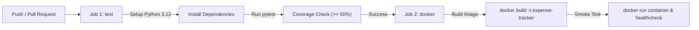

# 🧪 Тестування архітектури та CI/CD (Лабораторна робота №7)

## 1. Загальний огляд
У проєкті **Expense Tracker** впроваджено багаторівневу піраміду автоматизованого тестування. Тестовий набір на базі фреймворку `pytest` гарантує цілісність інваріантів предметної області, коректність сервісної бізнес-логіки та захист від регресій при змінах коду.

Всі перевірки автоматично виконуються у конвеєрі неперервної інтеграції **GitHub Actions** (`.github/workflows/ci.yml`).

---

## 2. Аудит тестового набору (Таблиця 1)

| Файл тесту | Рівень тестування | Що перевіряє | Кількість тестів | Середній час |
| :--- | :--- | :--- | :---: | :---: |
| [`tests/unit/test_validators.py`](file:///Users/mimi/Desktop/Antigravity/АтПпз/ExpenseTracker/backend/tests/unit/test_validators.py) | Модульний (Unit) | Pydantic-схеми, правила полів запитів, інваріанти | 10 | 0.11 с |
| [`tests/unit/test_services.py`](file:///Users/mimi/Desktop/Antigravity/АтПпз/ExpenseTracker/backend/tests/unit/test_services.py) | Модульний (Unit) | Бізнес-логіка `TransactionFacade`, репозиторії замінені на Mock | 5 | 0.89 с |
| [`tests/unit/test_balance.py`](file:///Users/mimi/Desktop/Antigravity/АтПпз/ExpenseTracker/backend/tests/unit/test_balance.py) | Модульний (Unit, TDD) | Чиста функція розрахунку балансу `calculate_balance` | 3 | 0.01 с |
| [`tests/integration/test_repository.py`](file:///Users/mimi/Desktop/Antigravity/АтПпз/ExpenseTracker/backend/tests/integration/test_repository.py) | Інтеграційний | Репозиторії транзакцій та категорій із Mock-клієнтом Supabase | 6 | 0.65 с |
| [`tests/test_exceptions.py`](file:///Users/mimi/Desktop/Antigravity/АтПпз/ExpenseTracker/backend/tests/test_exceptions.py) | Модульний / Валідація | Ієрархія доменних винятків `AppError` та `ExpenseValidator` | 13 | 1.15 с |
| **РАЗОМ** | | | **37** | **~2.81 с** |

---

## 3. Матриця перевірки архітектурних та бізнес-правил (Таблиця 2)

| Архітектурне / Бізнес-правило | Автоматизовані тести, що його покривають |
| :--- | :--- |
| **Тип транзакції лише `income` або `expense`** | `test_valid_income_transaction_passes`, `test_valid_expense_transaction_passes`, `test_invalid_type_raises_error` |
| **Сума транзакції $> 0$ та обов'язкова** | `test_negative_amount_raises_error`, `test_zero_amount_raises_error`, `test_missing_amount_raises_error` |
| **Спосіб оплати лише `cash`, `card`, `crypto` (дефолт: `card`)** | `test_invalid_payment_method_raises_error`, `test_default_payment_method_is_card` |
| **Валюта за замовчуванням USD, коментар опціональний** | `test_default_currency_is_usd`, `test_optional_comment_accepts_none` |
| **Баланс = Доходи мінус Витрати** | `test_balance_income_minus_expense`, `test_balance_empty_list_returns_zero`, `test_balance_only_expenses_is_negative`, `test_get_transactions_returns_sorted_list` |
| **Створення транзакції викликає збереження в репозиторії** | `test_create_transaction_calls_repository`, `test_create_and_retrieve` |
| **Видалення повертає `True` для наявного та `False` для відсутнього** | `test_delete_transaction_returns_true`, `test_delete_nonexistent_returns_false`, `test_delete_removes_record` |
| **Дані витрати валідуються та очищаються** | `test_validator_raises_on_missing_amount`, `test_validator_raises_on_bad_category`, `test_validator_raises_on_bad_date`, `test_validator_returns_clean_data` |
| **Власні помилки мають код, опис та спільного предка `AppError`** | `test_business_error_hierarchy`, `test_database_error_hierarchy`, `test_app_error_base_to_dict` |

---

## 4. Аналіз піраміди тестування

* **Розподіл тестів:**
  * Модульні тести: **31 з 37 (84%)**
  * Інтеграційні тести: **6 з 37 (16%)**
  * Наскрізні (E2E) тести: винесені на ручне приймальне тестування через Telegram Mini App.
* **Піраміда класична, не перевернута:** Більшість тестів — найшвидші та ізольовані модульні перевірки.
* **Повна ізоляція від мережі:** Всі тести використовують підмінені фікстури (`MagicMock`) для Supabase, тому набір виконується стабільно без підключення до Інтернету і без ризику спотворення робочих даних у БД.

---

## 5. Звіт про покриття коду (Code Coverage)

Запуск команди:
```bash
python3 -m pytest --cov=src --cov-fail-under=50 -v
```

### Підсумкова таблиця покриття (59%):
```
Name                                  Stmts   Miss  Cover
---------------------------------------------------------
src/__init__.py                           0      0   100%
src/api/__init__.py                       0      0   100%
src/core/config.py                       24      0   100%
src/core/database.py                     12      3    75%
src/core/logger.py                       35      2    94%
src/core/security.py                     74     53    28%
src/exceptions.py                        42      0   100%
src/models/schemas.py                   115      0   100%
src/patterns/patterns.py                154     39    75%
src/repositories/repositories.py        141     75    47%
src/services/services.py                 96     43    55%
src/validators/expense_validator.py      48      6    88%
---------------------------------------------------------
TOTAL                                   874    355    59%
```
Мінімальний поріг у 50%, зафіксований в ADR-001 та вимогах курсу, перевищено (**59%**).

---

## 6. Конвеєр неперервної інтеграції (CI/CD Pipeline)

Конфігурація GitHub Actions знаходиться у файлі [`.github/workflows/ci.yml`](file:///Users/mimi/Desktop/Antigravity/АтПпз/ExpenseTracker/.github/workflows/ci.yml) і складається з двох завдань (jobs):



1. **Job `test`:** Розгортає оточення Python 3.12, встановлює залежності, інжектує тестові змінні середовища та запускає `pytest --cov=src --cov-fail-under=50 -v`.
2. **Job `docker`:** Збирає Docker-образ за `Dockerfile`, запускає тестовий контейнер на порті 8000, перевіряє його запуск і зупиняє.
