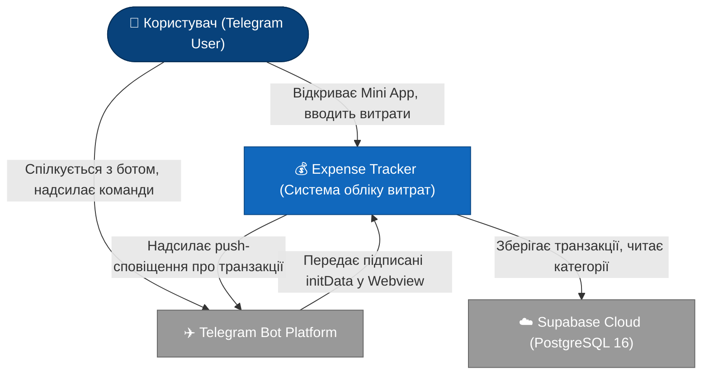
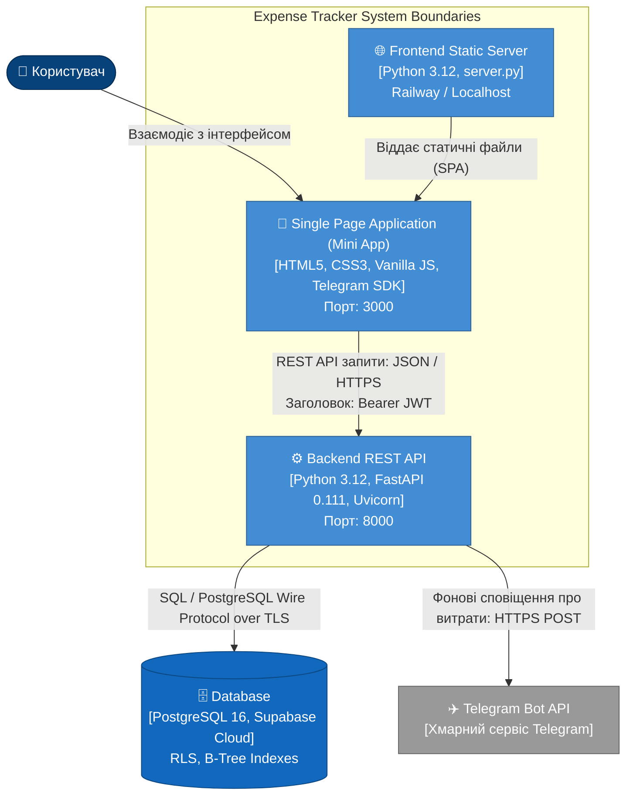
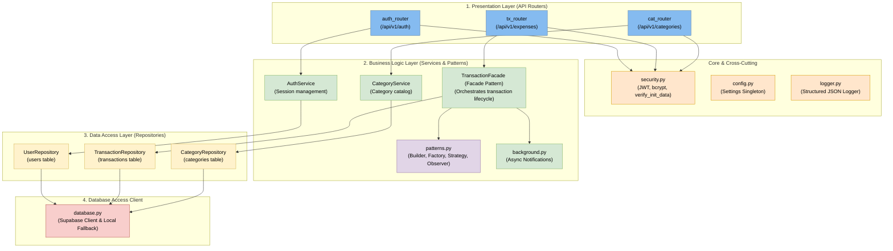

# 📐 Архітектурна модель C4 (Лабораторна робота №8)

## 1. Загальний огляд
Для документування архітектури **Expense Tracker** використано підхід **C4 Model** (Context, Containers, Components). Діаграми структуровано за рівнями деталізації без змішування контекстів.

---

## 2. Зацікавлені сторони (Stakeholders — Таблиця 1)

| Зацікавлена сторона | Інтерес до системи | Найважливіший атрибут якості |
| :--- | :--- | :--- |
| **Кінцевий користувач** | Швидкий, простий облік витрат без паролів у звичному інтерфейсі Telegram | Зручність використання (Usability), Продуктивність (Performance) |
| **Команда розробників** | Модульність коду, простота додавання нових фіч та наочність патернів | Модифікованість (Maintainability), Тестованість (Testability) |
| **Викладач / Екзаменатор** | Відповідність архітектурним принципам, наявність GoF патернів, висока якість тестів і звітності | Архітектурна відповідність (Conformance), Документованість |
| **Хмарний хостинг (Railway / Supabase)** | Економічне споживання пам'яті та процесорного часу в межах безкоштовного тарифу | Ресурсоефективність (Efficiency), Надійність (Reliability) |
| **Екосистема Telegram** | Дотримання специфікації Telegram WebApp SDK, відсутність спаму та надійність Webhook | Безпека (Security), Сумісність (Interoperability) |

---

## 3. C4 Рівень 1 — Діаграма контексту системи (System Context)

Відображає систему як єдиний «чорний ящик» у взаємодії з користувачами та зовнішніми хмарними сервісами.

---

## 4. C4 Рівень 2 — Діаграма контейнерів (Container Diagram)

Показує розгортання системи у вигляді окремих виконуваних контейнерів та протоколи взаємодії.

---

## 5. C4 Рівень 3 — Діаграма компонентів бекенду (Component Diagram)

Розкриває внутрішню структуру контейнера `Backend API` та 4-рівневу архітектуру **Modular Monolith**:

---

## 6. Глосарій предметної області (Domain Glossary — Таблиця 2)

| Термін | Семантичне значення у системі |
| :--- | :--- |
| **Transaction (Транзакція)** | Фіксація фінансової операції: дохід (`income`) або витрата (`expense`) із зазначенням суми, валюти, дати, категорії та способу оплати. |
| **Category (Категорія)** | Класифікатор транзакцій (наприклад, 🍔 Food, 🚗 Transport). Поділяється на системні (`is_default = true`) та користувацькі. |
| **Telegram Mini App (TMA)** | Клієнтський веб-додаток, інтегрований у месенджер Telegram через Webview та WebApp SDK. |
| **initData** | Криптографічно підписаний рядок даних користувача, який Telegram передає клієнту під час відкриття Mini App. |
| **TransactionFacade** | Сервіс бізнес-логіки (патерн Facade), що забезпечує єдину точку входу для створення транзакцій, виклику Builder, платіжних фабрик та шини подій. |
| **Row Level Security (RLS)** | Механізм безпеки PostgreSQL на рівні рядків таблиці, що запобігає витоку даних між користувачами. |
| **PaymentMethod** | Спосіб здійснення фінансової операції: готівка (`cash`), картка (`card`), криптовалюта (`crypto`). |
| **EventBus** | Реалізація шаблону Observer у пам'яті додатку для розсилки подій (`transaction.created`) підписникам. |
| **Modular Monolith** | Архітектурний стиль побудови бекенду: монолітна кодова база, розділена на чіткі слабозв'язані шари (Layers). |
