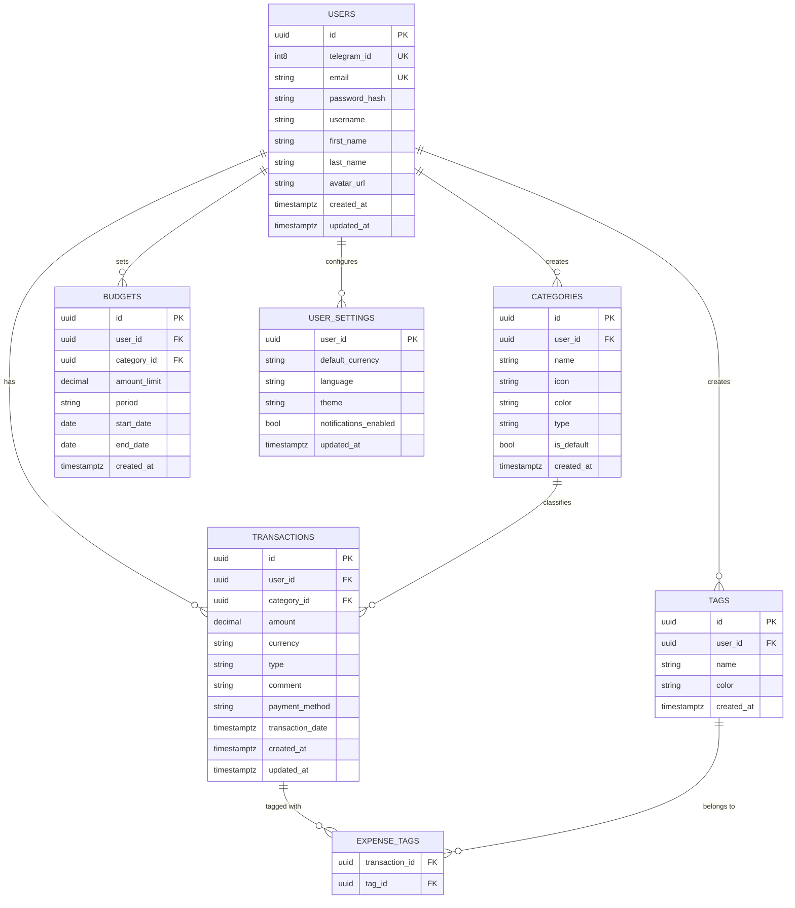

# 🗄️ Архітектура даних та сховища (Лабораторна робота №5)

## 1. Загальний огляд
Дані системи **Expense Tracker** зберігаються у хмарній реляційній системі керування базами даних **PostgreSQL 16** під управлінням платформи **Supabase**. Архітектура орієнтована на забезпечення суворої ізоляції користувачів, високої швидкодії аналітичних вибірок та дотримання цілісності фінансових операцій.

---

## 2. Реляційна модель та 3NF-нормалізація

Схема складається з 7 основних таблиць, спроєктованих у **третій нормальній формі (3NF)**:



### Обґрунтування нормалізації:
1. **1NF:** Усі атрибути атомарні; повторювані групи відсутні; множинний зв'язок тегів із транзакціями винесено в проміжну таблицю `expense_tags`.
2. **2NF:** Усі неключові атрибути повністю функціонально залежать від первинних ключів. У складеному ключі `expense_tags(transaction_id, tag_id)` атрибути залежать від усього ключа.
3. **3NF:** Відсутні транзитивні функціональні залежності. Наприклад, категорія зберігається окремо від транзакції, її назва й іконка не дублюються в рядках транзакцій.

---

## 3. Стратегія індексації (B-Tree Indexes)

Для гарантії часу відгуку $p95 \le 500$ мс під навантаженням створено такі індекси:

```sql
-- Швидкий пошук та авторизація за Telegram ID та Email
CREATE INDEX idx_users_telegram_id ON users(telegram_id);
CREATE INDEX idx_users_email ON users(email);
CREATE INDEX idx_users_username ON users(username);

-- Фільтрація та сортування журналу транзакцій користувача
CREATE INDEX idx_transactions_user_id ON transactions(user_id);
CREATE INDEX idx_transactions_date ON transactions(transaction_date DESC);
CREATE INDEX idx_transactions_user_date ON transactions(user_id, transaction_date DESC);
CREATE INDEX idx_transactions_user_type ON transactions(user_id, type);
CREATE INDEX idx_transactions_category ON transactions(category_id);

-- Категорії: швидке об'єднання системних та власних
CREATE INDEX idx_categories_user_id ON categories(user_id);
CREATE INDEX idx_categories_type ON categories(type);
```

---

## 4. Безпека даних: Row Level Security (RLS)

Усі таблиці мають активований механізм **Row Level Security (RLS)**:

```sql
ALTER TABLE users ENABLE ROW LEVEL SECURITY;
ALTER TABLE transactions ENABLE ROW LEVEL SECURITY;
ALTER TABLE categories ENABLE ROW LEVEL SECURITY;
ALTER TABLE budgets ENABLE ROW LEVEL SECURITY;

-- Політика ізоляції транзакцій:
CREATE POLICY "Users can only access their own transactions"
    ON transactions
    FOR ALL
    USING (auth.uid() = user_id)
    WITH CHECK (auth.uid() = user_id);

-- Політика для категорій:
CREATE POLICY "Users can access system and own categories"
    ON categories
    FOR SELECT
    USING (is_default = TRUE OR auth.uid() = user_id);
```

---

## 5. Міграції бази даних

Схема розгортається декларативно через SQL-міграції:
* [`sql/schema.sql`](file:///Users/mimi/Desktop/Antigravity/АтПпз/ExpenseTracker/sql/schema.sql) — повна початкова схема (таблиці, констрейнти `CHECK`, тригери `updated_at`, дефолтні категорії).
* [`sql/migration_001_add_user_fields.sql`](file:///Users/mimi/Desktop/Antigravity/АтПпз/ExpenseTracker/sql/migration_001_add_user_fields.sql) — міграція розширення профілю Telegram (`first_name`, `last_name`, `username`, `avatar_url`) та додаткових індексів.

---

## 6. Резервне копіювання та відновлення (Backup & Recovery)

1. **Point-In-Time Recovery (PITR):** Хмарна платформа Supabase веде безперервний журнал випереджувального запису (WAL), що дозволяє відновити стан БД до будь-якої секунди за останні 7 діб.
2. **Щоденні бекапи:** Автоматичні щоденні знімки (snapshot) зберігаються у зашифрованому S3-сховищі.
3. **Локальний аварійний експорт:** Дамп схеми та даних створюється командою:
   ```bash
   pg_dump -h db.supabase.co -U postgres -d postgres -F c -b -v -f backup_$(date +%Y%m%d).dump
   ```
